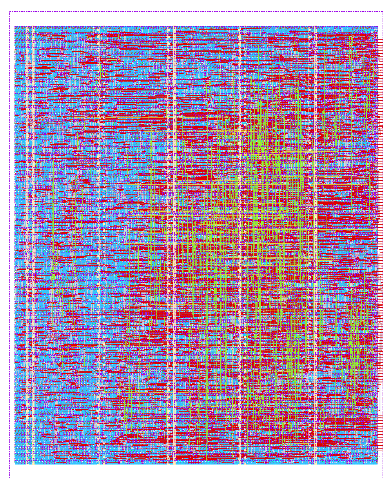

# RVDBG4614 Datasheet

RISC-V Debug Module hard macro (PULP riscv-dbg: JTAG DTM + Debug Module) -
IHP SG13G2 130 nm BiCMOS, `sg13g2_stdcell` library.

## Key features

- RISC-V External Debug Support v0.13.2 (`dmstatus.version` = 2)
- JTAG Debug Transport Module, IR length 5, IDCODE `0x0000_0DB3`
- Execution-based run control for one hart: halt, resume, single step, `ndmreset`
- Abstract commands (Access Register, 32-bit) and 8-word program buffer
- System Bus Access: 32-bit address, 8/16/32-bit accesses, auto-increment
- OBI subordinate port (debug memory) and OBI manager port (SBA)
- Asynchronous JTAG and system clock domains, 2-phase CDC with reset controller
- Signal routing limited to Metal1-Metal5; TopMetal1/TopMetal2 free for the parent design (except the macro's TopMetal1 power straps)

## Physical data

| Parameter | Value |
| --- | --- |
| Macro size (die) | 400.0 µm × 500.0 µm (0.20 mm²) |
| Core area | 388.3 µm × 468.7 µm |
| Standard-cell area (excluding fill/decap) | 118 101 µm² |
| Core utilization | 64.9 % |
| Synthesized logic area (Yosys) | 101 350 µm², 5 554 cells |
| Flip-flops | 1 119 (`sg13g2_dfrbpq_1`) |
| Signal pins | 263 (265 pins including the 2 power pins) |
| Routing layers | Metal1-Metal5 (signals and clock), TopMetal1 (PDN straps) |
| Power pins | `VDD`, `VSS` (TopMetal1 vertical straps) |
| Total wire length | 318.3 mm |

Pin placement: all 263 signal pins are on the **east** side (Metal3), from
bottom to top: OBI subordinate port (`slave_*`), clocks, resets, test mode and
JTAG, hart control/status and `hartinfo_i`, OBI manager port (`master_*`). The
north, south and west sides have no signal pins. The exact coordinates are in
the LEF view; the order is defined in
`RVDBG4614-main/Flow/scripts/LibreLane/pin_order.cfg`.

## Timing (post-route sign-off, extracted parasitics)

Constraints: `clk_i` 10 ns (100 MHz), `jtag_tck_i` 25 ns (40 MHz), clock
uncertainty 0.1 ns, clock transition 0.2 ns, I/O delays 30 % of the clock
period (see `RVDBG4614-main/constraints/sdc/RVDBG4614.sdc`).

| Corner | Setup WNS | Setup violations | Hold WNS | Hold violations |
| --- | --- | --- | --- | --- |
| nom_slow_1p08V_125C | +1.801 ns | 0 | +0.385 ns | 0 |
| nom_typ_1p20V_25C | +2.216 ns | 0 | +0.206 ns | 0 |
| nom_fast_1p32V_m40C | +2.434 ns | 0 | +0.100 ns | 0 |

No maximum slew or capacitance violations in any corner. Worst setup clock
skew: 0.43 ns (slow corner).

Clock-domain crossings (inside `dmi_cdc` only) are constrained to settle
within `min(T_clk_i, T_tck)` (bundled data and handshakes) and within 3 ns for
synchronizer first stages (metastability margin).

## Power (post-route, default switching activity, `clk_i` = 100 MHz, `jtag_tck_i` = 40 MHz)

| Corner | Internal | Switching | Leakage | Total |
| --- | --- | --- | --- | --- |
| nom_typ_1p20V_25C | 6.57 mW | 1.57 mW | 4.7 µW | 8.14 mW |
| nom_slow_1p08V_125C | 5.23 mW | 1.22 mW | 7.0 µW | 6.45 mW |
| nom_fast_1p32V_m40C | 8.06 mW | 2.00 mW | 15.6 µW | 10.08 mW |

About 66 % of the power is sequential (1 119 flops clocked every cycle) and
22 % is the clock network. These figures use OpenSTA's default activity and
are an upper-bound estimate: in normal operation the debug module is idle and
the hart only accesses it while in debug mode. Worst IR drop on `VDD`: 8.6 mV.

## Sign-off summary

| Check | Tool | Result |
| --- | --- | --- |
| DRC | Magic, KLayout (IHP SG13G2 decks) | 0 violations |
| Antenna | OpenROAD | 0 violating nets |
| LVS | Netgen | Circuits match uniquely |
| STA, 3 corners | OpenSTA (OpenRCX parasitics) | 0 setup / 0 hold violations |
| Lint | Verilator `-Wall` | 0 warnings (justified waivers in `verilator_cfg.vlt`) |

## Deliverables (release v.1.0.0)

| View | Location |
| --- | --- |
| GDSII | `release/v.1.0.0/RVDBG4614.gds`, `release/v.1.0.0/views/gds/` |
| LEF abstract | `release/v.1.0.0/views/lef/RVDBG4614.lef` |
| Liberty (3 corners) | `release/v.1.0.0/views/lib/` |
| SDF (3 corners) | `release/v.1.0.0/views/sdf/` |
| SPEF | `release/v.1.0.0/views/spef/nom/` |
| Gate-level netlists (with/without power pins) | `release/v.1.0.0/views/nl/`, `views/pnl/` |
| SPICE netlist (LVS) | `release/v.1.0.0/views/spice/` |
| DEF, OpenDB, Magic views | `release/v.1.0.0/views/{def,odb,mag,mag_gds}/` |
| Verilog header / JSON header | `release/v.1.0.0/views/{vh,json_h}/` |
| Timing constraints used for sign-off | `release/v.1.0.0/views/sdc/` |
| Flow metrics | `release/v.1.0.0/views/metrics.{csv,json}` |

## Layout

