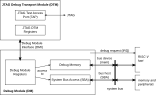

# RVDBG4614 Specification

## 1. Scope

RVDBG4614 is a hard macro of the PULP Platform
[riscv-dbg](https://github.com/pulp-platform/riscv-dbg) debug system for the
IHP SG13G2 130 nm BiCMOS technology. It implements the run-control and system
bus access functions of the
[RISC-V External Debug Support specification v0.13.2](https://github.com/riscv/riscv-debug-spec/raw/4e0bb0fc2d843473db2356623792c6b7603b94d4/riscv-debug-release.pdf)
for one RISC-V hart, accessed by an external debugger (e.g. OpenOCD + GDB)
through a JTAG port.

The detailed description of the upstream debug system (register map, DTM
registers, debug memory map) is in [debug-system.md](debug-system.md).

## 2. Requirements

| ID | Requirement | Implementation |
| --- | --- | --- |
| R1 | RISC-V Debug Specification v0.13.2 compliance (`dmstatus.version` = 2) | upstream riscv-dbg |
| R2 | JTAG (IEEE 1149.1) access with a RISC-V compliant DTM (IDCODE, DTMCS, DMI) | `dmi_jtag`, `dmi_jtag_tap` (IR length 5) |
| R3 | Halt, resume, single step, `ndmreset` | `dm_csrs`, `dm_mem` |
| R4 | Access to hart GPRs/CSRs through abstract commands | `dm_mem` (execution-based, debug ROM + generated abstract command code) |
| R5 | Program buffer with 8 entries | `dm::ProgBufSize = 8` |
| R6 | System Bus Access, 32-bit addresses, 8/16/32-bit accesses, auto-increment | `dm_sba` over the OBI manager port |
| R7 | Integration through standard OBI interfaces | `dm_obi_top` |
| R8 | Asynchronous JTAG and system clocks | `dmi_cdc` (2-phase CDC with reset controller) |
| R9 | Hard macro in IHP SG13G2, routing below TopMetal1, all pins on one side | LibreLane flow, `RT_MAX_LAYER = Metal5`, all pins on the east side |
| R10 | System clock target 100 MHz, JTAG clock target 40 MHz | `constraints/sdc/RVDBG4614.sdc` |

## 3. Architecture

The macro top level `RVDBG4614` (`RVDBG4614-main/rtl/RVDBG4614.sv`)
instantiates:

- **`dmi_jtag` (DTM)** - JTAG TAP controller (`dmi_jtag_tap`) with the IDCODE,
  DTMCS and DMI access registers, clocked by `jtag_tck_i`. The TAP drives TDO
  on the falling TCK edge. DMI requests and responses cross into the system
  clock domain through `dmi_cdc`, which uses two `cdc_2phase_clearable`
  instances (request 41 bit, response 34 bit) with a 4-phase reset controller
  so that a DMI reset (`dtmcs.dmihardreset`) cleanly clears both sides.
- **`dm_obi_top` (DM)** - `dm_top` wrapped with OBI-compliant subordinate and
  manager ports:
  - `dm_csrs`: Debug Module registers (`dmcontrol`, `dmstatus`, `abstractcs`,
    `command`, `data0-1`, `progbuf0-7`, `sbcs`, `sbaddress`, `sbdata`, ...);
  - `dm_mem`: the debug memory seen by the hart over the OBI subordinate port
    (debug ROM, halt/resume/going flags, abstract command and program buffer
    region, data registers);
  - `dm_sba`: System Bus Access master on the OBI manager port.

The debug method is execution based: on a halt request the DM asserts
`debug_req_o`; the hart enters debug mode and executes the debug ROM from the
DM memory (park loop). Abstract commands and program-buffer contents are
executed by the hart from the DM memory.

### Fixed configuration

| Parameter | Value | Notes |
| --- | --- | --- |
| `NrHarts` | 1 | one hart, `hartsel` = 0 |
| `BusWidth` | 32 | OBI data and address width |
| `IdWidth` | 4 | OBI `aid`/`rid` width of the subordinate port |
| `DmBaseAddress` | `0x1000` (non-zero) | selects the position-independent debug ROM (uses `auipc`); requires `hartinfo.nscratch = 2` |
| `IdcodeValue` | `0x0000_0DB3` | upstream default (manufacturer 0x6D9, part 0, version 0) |
| `dm::ProgBufSize` | 8 | program buffer words |
| `dm::DataCount` | 2 | abstract data registers |

Changing a parameter requires re-running the physical flow.

### Debug memory map (OBI subordinate port, offsets from the DM base)

| Offset | Content |
| --- | --- |
| `0x100` | halted flag (written by the hart) |
| `0x108` | going flag |
| `0x110` | resuming flag |
| `0x118` | exception flag |
| `0x300` | "where to" jump instruction (to resume, abstract command or program buffer) |
| `0x338`-`0x35F` | abstract command code (10 words, generated by the DM) |
| `0x360`-`0x37F` | program buffer `progbuf0`-`progbuf7` |
| `0x380`-`0x387` | abstract data registers `data0`-`data1` (`dm::DataAddr`) |
| `0x400`-`0x7FF` | per-hart flags (read by the hart in the park loop) |
| `0x800`-`0xFFF` | debug ROM; entry at `0x800` = halt address (`dm::HaltAddress`) |
| `0x808` | resume address |
| `0x810` | exception address (`dm::ExceptionAddress`) |

The DM decodes only the 12 least significant address bits; the subordinate
port must be mapped to a 4 KiB-aligned window (Croc maps it at `0x0000_0000`).

## 4. Interfaces

All signal pins are on the east side of the macro (Metal3), ordered from
bottom to top as the tables below: OBI subordinate port, clock/reset/test
and JTAG, hart interface, OBI manager port.

### Clock, reset and test

| Port | Dir | Width | Description |
| --- | --- | --- | --- |
| `clk_i` | in | 1 | system clock (DM, OBI ports) |
| `rst_ni` | in | 1 | asynchronous active-low reset of the system domain; connect the power-on reset, not `ndmreset_o` |
| `testmode_i` | in | 1 | DFT test mode; selects the non-inverted TCK for the TDO flops. Tie to 0 in functional mode (timing is signed off with `testmode_i = 0`) |

### JTAG

| Port | Dir | Width | Description |
| --- | --- | --- | --- |
| `jtag_tck_i` | in | 1 | JTAG test clock, must be slower than `clk_i` |
| `jtag_tms_i` | in | 1 | test mode select, sampled on rising TCK |
| `jtag_trst_ni` | in | 1 | asynchronous active-low test reset |
| `jtag_tdi_i` | in | 1 | test data in, sampled on rising TCK |
| `jtag_tdo_o` | out | 1 | test data out, changes on falling TCK |
| `jtag_tdo_oe_o` | out | 1 | TDO output enable (Shift-IR/Shift-DR) |

### Hart interface

| Port | Dir | Width | Description |
| --- | --- | --- | --- |
| `debug_req_o` | out | 1 | debug (halt) request to the hart |
| `ndmreset_o` | out | 1 | non-debug-module reset request (`dmcontrol.ndmreset`) |
| `dmactive_o` | out | 1 | debug module active (`dmcontrol.dmactive`) |
| `unavailable_i` | in | 1 | hart unavailable (e.g. powered down) |
| `hartinfo_i` | in | 32 | `dm::hartinfo_t` value of the hart; for CVE2/Ibex use `nscratch = 2`, `dataaccess = 1`, `datasize = 2`, `dataaddr = 0x380` (`0x0021_2380`) |

> **Note - `ndmreset` acknowledgement.** `dm_top` has an `ndmreset_ack_i`
> input that should pulse when the system reset requested by `ndmreset` has
> completed, and that sets `dmstatus.allhavereset`/`anyhavereset`. Upstream's
> `debug-system.md` lists it as a top-level input, but `dm_obi_top` (and so
> this macro) does not expose it. It ties it to `ndmreset_o` instead. As a
> result, `havereset` is set as soon as `ndmreset` is asserted, and set again
> on every cycle while `ndmreset` stays high, not when the reset has actually
> completed. A debugger must not use `havereset` to decide when the system has
> come out of reset. It should clear `ndmreset`, wait a time based on the
> system reset length, and then clear `havereset` with
> `dmcontrol.ackhavereset`.

### OBI subordinate port (hart -> debug memory)

| Port | Dir | Width | Description |
| --- | --- | --- | --- |
| `slave_req_i` | in | 1 | request |
| `slave_gnt_o` | out | 1 | grant (always 1) |
| `slave_we_i` | in | 1 | write enable |
| `slave_addr_i` | in | 32 | byte address |
| `slave_be_i` | in | 4 | byte enables |
| `slave_wdata_i` | in | 32 | write data |
| `slave_aid_i` | in | 4 | transaction ID |
| `slave_rvalid_o` | out | 1 | response valid, one cycle after the granted request |
| `slave_rdata_o` | out | 32 | read data |
| `slave_rid_o` | out | 4 | response ID (= `aid` of the request) |

### OBI manager port (System Bus Access)

| Port | Dir | Width | Description |
| --- | --- | --- | --- |
| `master_req_o` | out | 1 | request |
| `master_addr_o` | out | 32 | byte address |
| `master_we_o` | out | 1 | write enable |
| `master_wdata_o` | out | 32 | write data |
| `master_be_o` | out | 4 | byte enables |
| `master_gnt_i` | in | 1 | grant |
| `master_rvalid_i` | in | 1 | response valid |
| `master_err_i` | in | 1 | bus error |
| `master_other_err_i` | in | 1 | other error (priority over `master_err_i`) |
| `master_rdata_i` | in | 32 | read data |

## 5. Integration requirements

- The hart must support the RISC-V debug mode with `dpc`, `dcsr` and two debug
  scratch registers (`dscratch0/1`), enter debug mode at `<DM base> + 0x800` on
  `debug_req_o` and jump to `<DM base> + 0x810` on an exception in debug mode.
- `jtag_tck_i` must be slower than `clk_i` (upstream limitation, see
  riscv-dbg issue #163).
- Connect `rst_ni` to the power-on reset so that `ndmreset_o` (which typically
  resets the rest of the system) does not reset the debug module.
- Tie `testmode_i` to 0 unless the DFT behaviour is required.
- The I/O timing budget assumed at the macro boundary is 30 % of the clock
  period for inputs and outputs of both domains (see the SDC); the OBI ports
  are not internally registered at the inputs.

## 6. Design and verification flow

| Step | Tool | Entry point |
| --- | --- | --- |
| Lint | Verilator 5.046 (`-Wall`) | LibreLane `Verilator.Lint` |
| RTL / gate-level simulation | Verilator 5.046 | `make simulate-{rtl,postsynth,postpnr}` |
| Upstream unit regressions | Verilator 5.046, Bender | `testbench/riscv-dbg/ci` |
| Synthesis | Yosys 0.64 + yosys-slang | LibreLane |
| Floorplan, placement, CTS, routing | OpenROAD | LibreLane |
| Parasitic extraction, STA | OpenRCX, OpenSTA (3 corners) | LibreLane |
| DRC / antenna | Magic, KLayout | LibreLane |
| LVS | Netgen | LibreLane |
