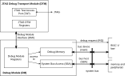

## RVDBG4614 RISC-V Debug Module

### Overview and Origin

The IP is the RISC-V debug system developed by the PULP Platform team at ETH
Zürich and the University of Bologna,
[riscv-dbg](https://github.com/pulp-platform/riscv-dbg), distributed under the
Solderpad Hardware License v0.51 (parts derived from SiFive code under the
Apache License 2.0). It implements the RISC-V External Debug Support
specification v0.13.2 and is used in the CVA6, CV32E40P, Ibex/CVE2 based
systems and in the Croc and Cheshire SoCs. It provides run-control debug
(halt, resume, single step), access to the hart registers and System Bus
Access to the memory map, controlled by an external debugger (e.g.
OpenOCD + GDB) through a JTAG port.

Within the project, the original IP was reorganized according to the EuroCDP
IP directory and release structure. The resulting package was enhanced with a
hard-macro top level, a reproducible physical-design flow, a system-level
simulation flow at RTL, post-synthesis and post-layout level, implementation
reports and release deliverables.

The current release targets the IHP 130nm BiCMOS process design kit using the
SG13G2 standard-cell library. In addition to the synthesizable RTL
implementation, the release includes a placed-and-routed hard macro and the
associated logical, physical, timing, and verification views required for
integration into a larger design.

### Functional Architecture

The architecture of the debug system is summarized in
Figure [1](#fig:rvdbg_architecture).

<figure id="fig:rvdbg_architecture" data-latex-placement="htbp">

<figcaption>Architecture of the RISC-V debug system, from the <a
href="https://github.com/pulp-platform/riscv-dbg/blob/master/doc/debug-system.md">riscv-dbg
documentation</a></figcaption>
</figure>

The macro `RVDBG4614` bundles the two halves of the debug system:

- the JTAG Debug Transport Module (`dmi_jtag`): a JTAG TAP with IDCODE, DTMCS
  and DMI registers in the JTAG clock domain, and a clock-domain crossing
  (`dmi_cdc`, two 2-phase CDCs with a 4-phase reset controller) into the
  system clock domain;

- the Debug Module (`dm_obi_top`): Debug Module registers (`dm_csrs`), the
  debug memory with debug ROM, abstract-command generator, 8-word program
  buffer and 2 data registers (`dm_mem`), and the System Bus Access master
  (`dm_sba`), all with OBI interfaces.

The debug method is execution based: on a halt request the hart enters debug
mode and executes code from the debug memory of the DM (debug ROM park loop,
abstract commands, program buffer), fetched through the OBI subordinate port.
The macro is configured for one hart and 32-bit OBI buses; the debug ROM is
position independent, so the macro can be mapped at any 4 KiB-aligned base
address.

### Interfaces

The main characteristics of the macro interface are summarized in the table
below. The complete port list is given in the [specification](Specification.md).
All signal pins are placed on the east side of the macro.

| **Interface** | **Main signals** | **Description** |
|---------------|------------------|-----------------|
| Clock and reset | `clk_i`, `rst_ni` | System clock and asynchronous active-low (power-on) reset. |
| Test mode | `testmode_i` | DFT clock selection in the TAP; tie to 0 in functional mode. |
| JTAG | `jtag_tck_i`, `jtag_tms_i`, `jtag_trst_ni`, `jtag_tdi_i`, `jtag_tdo_o`, `jtag_tdo_oe_o` | IEEE 1149.1 port of the RISC-V Debug Transport Module. |
| Hart control | `debug_req_o`, `ndmreset_o`, `dmactive_o`, `unavailable_i`, `hartinfo_i` | Debug request to the hart, non-debug-module reset, hart status and information. |
| OBI subordinate | `slave_*` | Debug memory (ROM, program buffer, data, flags) accessed by the hart. |
| OBI manager | `master_*` | System Bus Access to the memory map. |

### Design and Implementation Flow

The IP was implemented using an automated RTL-to-GDS flow covering logical
verification, synthesis, physical implementation, timing analysis, physical
verification, and release packaging. The main stages were as follows:

1.  RTL lint with Verilator and RTL simulation of the upstream unit
    testbenches and of a complete SoC (Croc with a CVE2 core) using Verilator;

2.  logic synthesis using Yosys (with the yosys-slang SystemVerilog frontend);

3.  initial floorplanning and power-distribution planning;

4.  standard-cell placement and optimization;

5.  clock-tree synthesis for the system and JTAG clocks;

6.  global and detailed routing;

7.  parasitic extraction;

8.  multi-corner static timing analysis, including clock-domain-crossing
    constraints;

9.  design-rule checking, layout-versus-schematic verification, and
    antenna checking;

10. post-synthesis and post-route gate-level simulation;

11. packaging of logical, timing, physical, verification and documentation
    views.

The implementation environment is summarized below:

- Flow: LibreLane 3.0.2 (Classic flow);

- Process design kit: IHP 130nm BiCMOS (IHP-Open-PDK commit `be443daa`);

- Standard-cell library: `sg13g2_stdcell`;

- Clock period constraints: 10 ns system clock, 25 ns JTAG clock;

- Nominal target frequencies: 100 MHz (system), 40 MHz (JTAG);

- Execution and testing platform: IIC-OSIC-TOOLS container.

The implementation results are reproducible only within the recorded flow,
PDK, library, tool, and constraint configuration. Changes to tool versions,
routing settings, timing corners, or PDK revisions may produce different
timing, power, and physical-verification results.

### Physical Implementation Results

The principal implementation and sign-off results are reported in the table
below. Further details are in the [datasheet](Datasheet.md).

| **Metric** | **Result** |
|---|---|
| Macro dimensions | $400 \times 500~\mu\mathrm{m}$ |
| Pin placement | all 263 signal pins on the east side |
| Standard-cell area / utilization | 118 101 µm² / 64.9 % |
| Clock constraints | 10 ns (`clk_i`), 25 ns (`jtag_tck_i`) |
| Worst setup slack (slow corner) | +1.80 ns |
| Worst hold slack (fast corner) | +0.10 ns |
| Setup violations | 0 |
| Hold violations | 0 |
| DRC violations (Magic, KLayout) | 0 |
| Antenna violations | 0 |
| LVS | Circuits match uniquely |
| Total power (typical corner, default activity) | 8.1 mW |

The positive worst-case setup and hold slacks indicate that the implemented
macro meets the specified clock constraints in all analyzed timing corners
(slow 1.08 V/125 °C, typical 1.20 V/25 °C, fast 1.32 V/−40 °C). No setup or
hold violations were reported.

The routed layout also completed the available block-level
physical-verification checks without DRC or antenna violations. LVS confirmed
a unique match between the extracted layout and the reference circuit.

### Verification Status

The verification and sign-off status of the current release is summarized in
the table below.

| **Verification activity** | **Status** |
|---|---|
| RTL lint (Verilator `-Wall`) | Passed, 0 warnings (justified waivers) |
| RTL unit regressions (upstream: dm_mem ×7, multi-hart resume ×5, JTAG/DMI random) | Passed |
| RTL system simulation (Croc SoC, debug self test) | Passed |
| Synthesis checks | Passed |
| Post-synthesis gate-level simulation | Passed |
| Post-route gate-level simulation | Passed |
| Design-rule checking | Passed |
| Layout-versus-schematic verification | Passed |
| Multi-corner static timing analysis | Passed |
| Antenna verification | Passed |
| Clock-domain crossing analysis | Structural review and STA constraints only (no CDC tool) |
| OpenOCD compliance test (upstream) | Not performed |
| Logical equivalence checking / EQY | Not performed |
| Code coverage | Not measured |
| Silicon validation | Not performed |

The system simulation exercises the macro through its JTAG port in a complete
SoC: IDCODE check, debug module activation, System Bus Access writes and
reads, program loading, halt, abstract-command register read/write, program
buffer execution, resume and end-of-program detection. The same test was run
on the RTL, on the synthesized netlist and on the routed netlist (zero-delay
gate-level simulations with the IHP standard-cell models).

### Maturity Assessment

The IP is assessed at **IPRL5 - Full design at layout level**.

The RTL has been functionally verified, synthesized, placed, clock-routed, and
fully routed. The resulting hard macro has passed the available block-level
static timing, DRC, LVS, antenna, and gate-level simulation checks. The
release also includes implementation and integration documentation sufficient
to support evaluation and integration activities.

The IP remains pre-silicon. It has not been integrated into a fabricated test
chip, characterized on silicon, or validated under physical operating
conditions.

### Known Limitations

The following limitations apply to the current release:

- The configuration is fixed by the hard macro: one hart, 32-bit OBI buses,
  4-bit OBI IDs, JTAG IDCODE `0x0000_0DB3`. Other configurations require
  re-running the flow.

- The JTAG clock must be slower than the system clock (upstream limitation,
  riscv-dbg issue #163).

- Hardware triggers, halt groups, authentication and quick access are not
  implemented by the upstream design.

- Timing is signed off in functional mode (`testmode_i` = 0); the DFT clock
  path of the TAP is not timed.

- Formal logical equivalence checking between the RTL and the synthesized or
  routed netlists has not been completed.

- Clock-domain crossings were not analyzed with a dedicated CDC tool; they are
  limited to the upstream `dmi_cdc` structure and constrained in STA.

- Gate-level simulations are zero-delay; no SDF back-annotated simulation was
  run.

- No scan insertion, design-for-test implementation, or production test
  strategy is included.

- No silicon fabrication, measurement, or characterization results are
  available.

- The reported timing, power, and physical-verification results apply only to
  the recorded IHP 130nm BiCMOS PDK revision, the `sg13g2_stdcell` library,
  tool configuration, operating corners, and design constraints. Power figures
  use default switching activity.

- The release has been verified at block level and in a simulated SoC, and
  has not yet been validated in a fabricated top-level system integration.

### Conclusion

The IP directory provides a physically implemented and integration-documented
RISC-V debug module hard macro targeting the IHP 130nm BiCMOS technology. Its
RTL, synthesis, place-and-route, gate-level simulation, static timing, DRC,
LVS, and antenna results support an IPRL5 maturity assessment.
